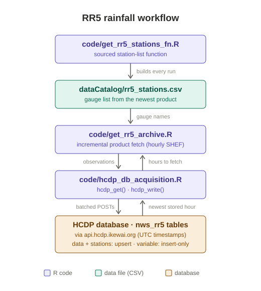

# RR5 rainfall workflow

Hourly collection of 1-hour rainfall totals for ~200 automated rain gauges
across the State of Hawaii, parsed from the National Weather Service
Honolulu office's **RR5HFO product** (Hawaii One-Hour Rainfall Summary, SHEF
format). The gauge network spans county hydronet, RAWS, USGS, UH-Mānoa
mesonet, HSOIS, and NOAA/USFWS stations plus the ASOS airports — most of
these gauges' rainfall is **not available through the NWS observations
API**, making this product the only public real-time source for them. Each
run asks the HCDP database for its newest stored hour, fetches only the
product-hours after it, and writes them to the database's `nws_rr5` tables
through the HCDP acquisition API. Nothing but the station list is written
locally.



## How it works

Each run:

1. **Load the master station list** — `Hawaii_Master_Station_Meta.csv`, for
   each gauge's `skn`, `lat` and `lng` (see [SKN and
   coordinates](#skn-and-coordinates)). An unreachable list stops the run
   before anything is fetched.
2. **Build the station list** — `get_rr5_stations(refresh = TRUE)` (from
   `code/get_rr5_stations_fn.R`) parses the newest product for each gauge's
   location text, source network, island and `latest_obs_api`, and writes
   `dataCatalog/rr5_stations.csv`. It costs two requests, so every run builds
   it fresh and nothing has to persist between runs.
3. **Size the fetch window from the database** — every RR5 product carries
   ALL gauges, so the incremental unit is hours of products, not per-station
   windows. One request (`GET .../nws_rr5/data?limit=1`, newest row first)
   returns the newest stored hour; the run fetches from there to now, with a
   12-hour minimum (re-collecting late or reissued hours) and the API's
   ~7-day product retention as the cap. An empty database gets the full 7
   days. A manual override is available
   (`Rscript code/get_rr5_archive.R 73` = newest 73 products).
4. **Fetch and parse** — each hourly product's SHEF text is parsed: the
   obs-ending hour comes from the `.B` header (HST, converted to UTC), gauge
   lines yield station and value. Coding: `M` (missing) → not written; `T`
   (trace) → 0.001 in. If an hour was reissued/corrected, the newest issuance
   wins.
5. **Write to the database** — `hcdp_write()` posts to the three `nws_rr5`
   tables in batches under the API's 100 KB request limit:

   | Table | Rows | On an existing key |
   |---|---|---|
   | `stationMetadata` | `station_id, station_name, skn, lat, lng` | replaced (upsert) |
   | `variableMetadata` | `variable, unit` — `precip_1hr`, `in` | left as is (insert-only) |
   | `data` | `station_id, timestamp, variable, value` | replaced (upsert) |

   Metadata goes first. Observations upsert on `station_id + timestamp +
   variable`, so a re-fetched value replaces the stored one, and are written
   oldest hour first: a run that dies partway leaves the database complete
   up to its newest stored hour, which is exactly where step 3 resumes.

Catch-up after downtime is automatic: the window stretches to match the gap
since the newest stored hour, up to the ~7-day retention — so runs must
happen at least weekly to avoid gaps.

A run only reads the database's single newest hour, so a gauge that has been
transmitting "M" no longer widens the window (the old local design sized it
off the most-behind gauge, which could pin every run at 7 days).

## SKN and coordinates

RR5 products carry no coordinates, so each gauge's `skn`, `lat` and `lng`
come from the HCDP master station list,
[`Hawaii_Master_Station_Meta.csv`](https://raw.githubusercontent.com/ikewai/hawaii_wx_station_mgmt_container/main/Hawaii_Master_Station_Meta.csv),
matched as in the MADIS and NWS API workflows:

- a gauge's `station_id` is looked up in the list's `NWS.id` column, and the
  matching row's `SKN`, `LAT` and `LON` are sent;
- an `NWS.id` listed more than once is ambiguous and treated as unmatched,
  and logged each run (currently `WUHH1`, which appears in RR5);
- unmatched gauges get NA for all three.

As of 2026-11-09, 136 of the 193 reporting gauges match. The rest — all 46
UH-Mānoa gauges (`AALH1` Kaala, …), the 8 ASOS airports (RR5 lists them by
their 3-letter IDs, `HNL`, `HTO`, …, where the master list uses `PHNL`,
`PHTO`, …), and a few others — are stored with NA until their `NWS.id`s are
added to the master list; the next run then fills them in, with no code
change. `station_name` is the product's location text (the master list's
name for a gauge no longer in the product). `HCDP_MASTER_META_URL` overrides
the list's URL.

## Timestamps are UTC

Every timestamp the workflow writes — observation `timestamp`s and
`latest_obs_api` in the station list — is UTC in ISO 8601 form,
`YYYY-MM-DDTHH:MM:SSZ`. The product's `.B` header hour is HST; it is
converted, never stored as local time. The container runs with `TZ=UTC`.

## Legacy local data

Until 2026-11-09 the workflow kept its record locally in
`data_out/rr5_master.csv` (459,472 rows, 2026-07-24 → 2026-11-10 UTC). On
2026-11-09 its 419,600 non-missing rows were loaded into the database
insert-only: 387,873 were new, and the other 31,727 — the last 7 days, which
the live pipeline had already written — were left as they were. Five gauges
that have not reported recently (KIOH1, MNRH1, WNHH1, KBSH1, ANHH1) got
their station rows from the master station list at the same time. The
database now holds the full record from 2026-07-24T02:00Z.
`data_out/` is no longer written; `code/append_rr5_master.R` is kept but no
longer run.

## Files

All R code lives in `code/`. Every path comes from the environment, so the
scripts run correctly from any working directory — and refuse to run at all
without it.

```
$RR5_PROJECT_ROOT/       <- REQUIRED; dataCatalog/ lands here
|-- code/                <- the .R files live here, together
|-- envs/rr5.env         <- the variables, ready to source
`-- token.env            <- HCDP API token (gitignored; never committed)
```

Nothing is inferred from a script's own location. `RR5_PROJECT_ROOT` must
be exported before the fetcher runs; an unset root, or one pointing at a
directory that does not exist, is a fatal error rather than a silent
fallback. See [Directory configuration](#directory-configuration).

| File | Role |
|---|---|
| `code/get_rr5_archive.R` | the fetcher — steps 1–5 above |
| `code/get_rr5_stations_fn.R` | station-list function (sourced; also runs standalone) |
| `code/hcdp_db_acquisition.R` | HCDP acquisition API client: `hcdp_get()`, `hcdp_write()` — the same client as the NWS API workflow. Sourcing it sends no requests; *running* it executes its examples, which include POSTs of empty data to all four sources' tables |
| `code/append_rr5_master.R` | legacy local master accumulator — no longer run |
| `code/install_deps.R` | one-time CRAN dependency installer |
| `cron_rr5.txt` | ready-to-install hourly crontab entry |
| `envs/rr5.env` | the required directory variables, ready to `source` |
| `containers/Dockerfile`, `containers/task.sh`, `envs/prod.env` | container image and entrypoint — see [Container](#container) |
| `token.env` | HCDP API token, read at run time (gitignored) |
| `dataCatalog/rr5_stations.csv` | gauge list, rebuilt every run |
| `data_out/rr5_master.csv` | legacy local record; no longer written — see [Legacy local data](#legacy-local-data) |
| `runlogs/` | cron stdout/stderr logs (gitignored) |

### Directory configuration

| Variable | Required | Default | Holds |
|---|---|---|---|
| `RR5_PROJECT_ROOT` | **yes** | — | project root; everything below defaults relative to it |
| `RR5_CODE_DIR` | no | `$RR5_PROJECT_ROOT/code` | the `.R` files; must exist |
| `RR5_DATA_CATALOG` | no | `$RR5_PROJECT_ROOT/dataCatalog` | station list; created on demand |
| `RR5_DATA_OUT` | no | `$RR5_PROJECT_ROOT/data_out` | legacy local master; read only by `append_rr5_master.R` |

`envs/rr5.env` holds these ready to source:

```bash
. /path/to/preliminary_nws_rr5_hourly/envs/rr5.env
```

**Why required rather than inferred.** The scripts used to derive the root
from their own location (`--file=` under `Rscript`, the sourced file's path
when sourced, the working directory otherwise). That last fallback was the
problem: sourced or launched in a way that lost the path, a run would
quietly build its directories wherever it happened to be standing and write
a full fetch into the wrong tree. Requiring the variable turns that silent
mis-write into an immediate, readable abort:

```
Error: RR5_PROJECT_ROOT is not set. This workflow requires its directories
to come from the environment -- export RR5_PROJECT_ROOT (see
envs/rr5.env) before running.
```

The names are `RR5_`-prefixed rather than a bare `PROJECT_ROOT`, so no two
of the hourly workflows can collide in a shell or crontab that has more than
one loaded.

## Usage

```bash
. envs/rr5.env                      # REQUIRED — sets RR5_PROJECT_ROOT
Rscript code/get_rr5_archive.R      # fetch and write to the database
```

**Run it once an hour, at :45 past the hour** (cron `45 * * * *`) — see
[Scheduling](#scheduling) for why :45. The script takes every path from the
environment, so it can be called from anywhere with no `cd` — but the
variables must be loaded first, in the same shell:

```bash
. /path/to/preliminary_nws_rr5_hourly/envs/rr5.env && \
  Rscript "$RR5_PROJECT_ROOT/code/get_rr5_archive.R"
```

The database client reads three more variables, all optional:

| Variable | Default | Purpose |
|---|---|---|
| `HCDP_TOKEN_FILE` | `$RR5_PROJECT_ROOT/token.env` | file holding the API token — the bare token, or a `NAME=value` line |
| `HCDP_API_URL` | `https://api.hcdp.ikewai.org` | API base URL (point it at a test server) |
| `HCDP_MASTER_META_URL` | the `Hawaii_Master_Station_Meta.csv` URL above | master station list used for `skn` / `lat` / `lng` |

The token needs `meso_admin` permission, which the API requires for writes.
A missing or empty token file stops the run at startup, before any fetching.

A run is quick — one listing request plus one request per product hour, and
a handful of POSTs: under 10 s for a typical 13-product hourly run (~2,300
rows; the 2026-11-09 15:45 cron run took 8 s), 36 s for a full 7-day window
(~31,700 rows).

### Scheduling

`cron_rr5.txt` holds the ready-to-install crontab entry — copy its last
line into `crontab -e`:

```
45 * * * * /bin/sh -c '. <abs>/envs/rr5.env && C=${RR5_CODE_DIR:-$RR5_PROJECT_ROOT/code} \
             && /usr/bin/Rscript "$C/get_rr5_archive.R"' \
             >> <abs>/runlogs/nwsrr5_hrly.out 2>> <abs>/runlogs/nwsrr5_hrly.err
```

**Upgrading from the local-master version: replace the installed line.**
Before 2026-11-09 the line chained `&& /usr/bin/Rscript
"$C/append_rr5_master.R"` after the fetcher. Run `crontab -e`, delete that
line, and paste the one above (or copy the last line of `cron_rr5.txt`).
Left in place the old line is harmless but pointless: the fetcher no longer
writes `data_out/rr5_obs_long.csv`, so the append refolds the last stale
snapshot into `data_out/rr5_master.csv` with no change (`+0` rows). As of
2026-11-09 the line installed on this host is still the old one.

**Sourcing the env file inside the cron command is mandatory.** Cron's
environment is minimal and inherits nothing from an interactive shell, so a
crontab line that just calls the script aborts every run. The
`${RR5_CODE_DIR:-...}` default keeps the line correct whether or not that
optional override is set in the env file.

**When: :45 past every hour.** This applies however the job is launched —
cron here, or the HCDP task runner for the container. Hawaii's offset from
UTC is a whole number of hours, so :45 is the same minute in HST and UTC,
and `45 * * * *` is correct whichever timezone the scheduler uses.

**Why :45.** The RR5HFO product is issued between :30 and :35 past
(measured across a full 7-day retention window; never later than :35), and
the product issued at `HH:30` carries the hour *ending* at `HH:00` — so :45
collects the freshest hour that exists with a 10-minute cushion. Running
earlier loses no data, since windows overlap and writes are keyed upserts,
but adds an hour of latency.

**Once an hour, no more often.** The product is issued once an hour and
every run already re-fetches at least the last 12 hours. The companion NWS
API workflow runs at :07 and HADS at :20, so none of them overlap.

The `/bin/sh -c '...'` wrapper keeps the redirects applied to the whole
chain, so anything the env file or the fetcher prints lands in the log
rather than in cron's mail.

Output lands in `runlogs/` (gitignored, created on demand):

| File | Holds |
|---|---|
| `runlogs/nwsrr5_hrly.out` | the full run transcript — every progress line |
| `runlogs/nwsrr5_hrly.err` | **only** warnings and errors; empty after a clean run |

That split is why the scripts report progress with `say()` (a thin `cat()`
wrapper) rather than `message()`, and wrap `library()` in
`suppressPackageStartupMessages()` — both of those write to stderr in R,
which would otherwise fill `.err` with routine chatter on every run. A
product withdrawn between listing and fetch shows up as a one-line
`HTTP 404` warning while the run continues. Note the logs append, so they
grow without bound; rotate or truncate them if that matters.

### What a run needs locally

| Needed | Why |
|---|---|
| `RR5_PROJECT_ROOT` exported | every path derives from it; unset is fatal at startup. See [Directory configuration](#directory-configuration). |
| `code/get_rr5_stations_fn.R`, `code/hcdp_db_acquisition.R` | sourced by the fetcher; must sit in `$RR5_CODE_DIR`. Missing either is fatal at startup. |
| `token.env` | the HCDP API token (or the file `$HCDP_TOKEN_FILE` names). Missing it is fatal at startup. |
| R ≥ 4.1 plus `httr2`, `jsonlite`, `dplyr`, `purrr`, `tibble`, `readr` | `jsonlite` is only *suggested* by `httr2`, so it must be listed explicitly. Run `Rscript code/install_deps.R` once. |
| network access to `api.weather.gov` | no API key — the API only requires a `User-Agent` header, set in the scripts |
| network access to `api.hcdp.ikewai.org` | the database lookup and writes |
| network access to `raw.githubusercontent.com` | the master station list; unreachable stops the run before it fetches |

Nothing needs to persist between runs: the station list is rebuilt every
run, and what has been collected lives in the database. `dataCatalog/` must
be writable, because each run writes the station list there.

### Container

Pushes to `main` that touch `code/`, `containers/` or `envs/prod.env` build
and push `ghcr.io/hcdp/task-preliminary-nws-rr5-hourly` via
`.github/workflows/build-and-push.yml`. The image (on
`ghcr.io/hcdp/task-base`) installs `httr2`, `jsonlite`, `dplyr`, `tibble`
and `readr`, and copies `code/`, `envs/prod.env` and `containers/task.sh`;
its `CMD` runs `task.sh`, which sets `TZ=UTC`, sources `envs/prod.env`
(`RR5_PROJECT_ROOT=/workspace/`) and runs the fetcher — there is no append
step any more. Schedule the container **at :45 past every hour**, like the
cron job.

The token is **not** in the image and is provisioned manually: place it at
`/workspace/token.env`, or anywhere with `HCDP_TOKEN_FILE` pointing at it.
Without one the container stops at startup with `token file not found`,
before fetching anything.

## Data notes

- Products come from
  `https://api.weather.gov/products/types/RR5/locations/HFO` — the same
  text shown on https://www.weather.gov/hfo/RR5_archive, but as JSON and
  with ~7 days of retention instead of 72 hours.
- The product is provisional, non-quality-controlled gauge data, passed
  through as transmitted — the legacy record includes at least one
  impossible value (949.62 in in one hour). Filter downstream.
- ~192 of the 200 listed gauges actively report; the rest transmit "M".
  203 gauges have appeared since collection began.
- For history beyond the 7-day retention, the same gauge network (minus the
  UH-Mānoa mesonet sites) is archived back to January 2011 in the Iowa
  Environmental Mesonet's `HI_DCP` feed — see `../get_iem_dcp.R`.

See `../WORKFLOWS.md` for the index of the four hourly workflows; the
companion NWS API workflow writes to the same HCDP database (`nws_api`
tables) with per-station windows.
